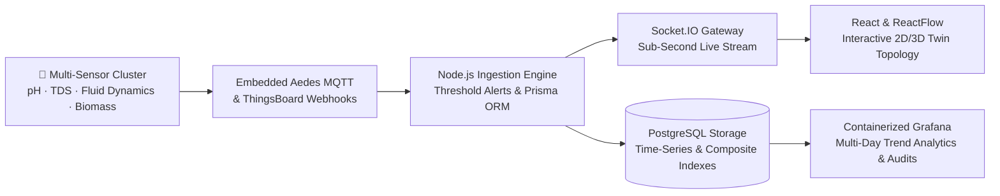

<!-- Top Animated Banner -->

  

  <!-- Animated Typing Header (Space Grotesk - Perfectly Centered, Zero Clipping) -->
  
    

  <!-- Badges (Cleanly linked without underline artifacts) -->
  &nbsp;&nbsp;&nbsp;

---

### 👋 Hey, I'm Bharath

I build scalable, hardware-integrated software systems that bridge physical sensor telemetry, event-driven backends, and interactive web visualization. My core focus is **real-time IoT data pipelines**, **digital twin platforms**, and **high-reliability full-stack web applications**, anchored by strong fundamentals in **Data Structures & Algorithms** and **relational database architectures**.

- 🌿 **Flagship**: Core Engineer on the **[Smart Hydroponic Digital Twin](https://github.com/bharathdnayak/hydroponic-digital-twin)** (NITK Surathkal CSE Research) — end-to-end platform simulating and tracing vertical farming telemetry from physical sensor drift to live 2D/3D visualization & time-series analytics.
- ⚙️ **Systems & Telemetry**: Architecting resilient hardware-telemetry pipelines via embedded **Aedes MQTT**, **ThingsBoard**, **Socket.IO**, and **PostgreSQL** with composite indexing and ACID-compliant concurrency.
- ⚡ **Algorithmic Practice**: Actively solving complex algorithmic and data-structure problems in **Java** (trees, graphs, dynamic programming, competitive programming).
- 💬 **Ask me about**: Full-stack architecture (React / Node / Express), MQTT broker telemetry pipelines, digital twin biological & physics simulation, time-series storage optimization, and database race-condition handling.

---

### 🌿 Flagship Architecture: Smart Hydroponic Digital Twin

> End-to-end digital twin platform tracing physical and biological signals through an event-driven telemetry pipeline to real-time interactive visualization and anomaly auditing.

| Architecture Layer | Telemetry & Simulation Engine | Historical Analytics & Storage |
| :--- | :--- | :--- |
| **Core Stack** | **Python (Physics/Growth Models) · Aedes MQTT · Socket.IO** | **PostgreSQL · Prisma ORM · Containerized Grafana** |
| **Ingestion Pipeline** | Sub-second telemetry streaming with automated threshold-based alerts | Time-series storage with composite indexing balancing query performance vs. overhead |
| **Simulation Scope** | Sensor drift, biological growth curves, nutrient fluid dynamics, and root growth | Multi-day metric aggregation, root-cause anomaly auditing, and trend analytics |
| **Visualization** | Interactive 2D/3D system topology rendered with **ReactFlow** & **React.js** | Production telemetry dashboards & long-term health heatmaps in Grafana |
| **Links** | 🔬 **NITK Surathkal Research Lab** (Dept. of CSE) | 💻 **[GitHub Repository](https://github.com/bharathdnayak/hydroponic-digital-twin)** |

---

### 🌟 Featured Projects Portfolio

<table align="center" width="100%">
  <thead>
    <tr>
      <th width="32%">Project</th>
      <th width="48%">Description</th>
      <th width="20%">Stack & Links</th>
    </tr>
  </thead>
  <tbody>
    <tr>
      <td>
        <b>🌿 <a href="https://github.com/bharathdnayak/hydroponic-digital-twin">Smart Hydroponic Digital Twin</a></b>
         
        <i>Real-Time IoT & Digital Twin Platform</i>
         
        ● NITK SURATHKAL RESEARCH
      </td>
      <td>
        End-to-end digital twin monitoring vertical farming environments. Employs Python physics models to simulate sensor drift, fluid dynamics, and biological growth, with an embedded Aedes MQTT broker, Socket.IO, and Grafana for live anomaly audits.
      </td>
      <td>
        
         
        <code>React</code> <code>Node.js</code> <code>MQTT</code> <code>PostgreSQL</code> <code>Prisma</code>
      </td>
    </tr>
    <tr>
      <td>
        <b>🏥 <a href="https://github.com/bharathdnayak/dreamdiagnosticscentre">Diagnostic Full-Stack Platform</a></b>
         
        <i>Healthcare Services & Diagnostics Portal</i>
         
        ● FULL-STACK HEALTHCARE
      </td>
      <td>
        End-to-end web platform enabling patient onboarding, appointment management, package selection, and diagnostic report access, backed by a rule-based health-insight suggestion engine.
      </td>
      <td>
        
         
        <code>React</code> <code>Express.js</code> <code>PostgreSQL</code> <code>REST APIs</code>
      </td>
    </tr>
    <tr>
      <td>
        <b>🚗 <a href="https://github.com/bharathdnayak">Smart Parking Management</a></b>
         
        <i>Database Concurrency & Reservation Engine</i>
      </td>
      <td>
        Database-driven parking reservation system engineered to eliminate double-booking via PostgreSQL transactions, database-level triggers, ACID guarantees, and strict concurrency control.
      </td>
      <td>
        
         
        <code>Node.js</code> <code>Express.js</code> <code>EJS</code> <code>PostgreSQL</code> <code>ACID</code>
      </td>
    </tr>
    <tr>
      <td>
        <b>🔬 <a href="https://github.com/bharathdnayak/Morphological-Noise-Removal-and-Classification-System">Morphological Noise Removal</a></b>
         
        <i>Digital Image Processing & Classification</i>
      </td>
      <td>
        Impulse noise reduction and feature classification pipeline leveraging mathematical morphology (dilation, erosion, opening, closing) to restore image fidelity while preserving edge boundaries.
      </td>
      <td>
        
         
        <code>Python</code> <code>OpenCV</code> <code>NumPy</code> <code>SciPy</code>
      </td>
    </tr>
    <tr>
      <td>
        <b>⚡ <a href="https://github.com/bharathdnayak/LeetCode-Submisson">Algorithmic Engineering</a></b>
         
        <i>Data Structures & Competitive Programming</i>
      </td>
      <td>
        Optimized implementations of core data structures, graph traversals, dynamic programming paradigms, and competitive problem-solving patterns in Java.
      </td>
      <td>
        
         
        
         
        <code>Java</code> <code>DSA</code> <code>Algorithms</code>
      </td>
    </tr>
    <tr>
      <td>
        <b>🛡️ <a href="https://github.com/bharathdnayak/multi-factor">Multi-Factor Authentication</a></b>
         
        <i>Identity Security & Access Management</i>
      </td>
      <td>
        Modular authentication system implementing multi-factor verification workflows, cryptographic credential hashing, session token integrity, and role-based access control.
      </td>
      <td>
        
         
        <code>Python</code> <code>Security</code> <code>Cryptography</code>
      </td>
    </tr>
  </tbody>
</table>

---

### 🛠️ Tech Stack & Arsenal

  
<strong>Languages & Core</strong>

  

  
<strong>Web & Frameworks</strong>

  

  
<strong>Databases & ORM</strong>

  

  
<strong>IoT, Cloud & Tools</strong>

  

---

### 📊 GitHub Activity & Analytics

  <picture>
    <source media="(prefers-color-scheme: dark)" srcset="https://github-readme-stats.vercel.app/api?username=bharathdnayak&show_icons=true&theme=tokyonight&hide_border=true&bg_color=0d1117" />
    
  </picture>
  <picture>
    <source media="(prefers-color-scheme: dark)" srcset="https://streak-stats.demolab.com/?user=bharathdnayak&theme=tokyonight&hide_border=true&background=0d1117" />
    
  </picture>

 

  Open to Full-Stack, IoT / Systems engineering opportunities & collaborations · Reach me on <a href="https://www.linkedin.com/in/bharath-d-nayak/">LinkedIn</a> or via <a href="mailto:bharathdnayak13@gmail.com">bharathdnayak13@gmail.com</a>
    
  

